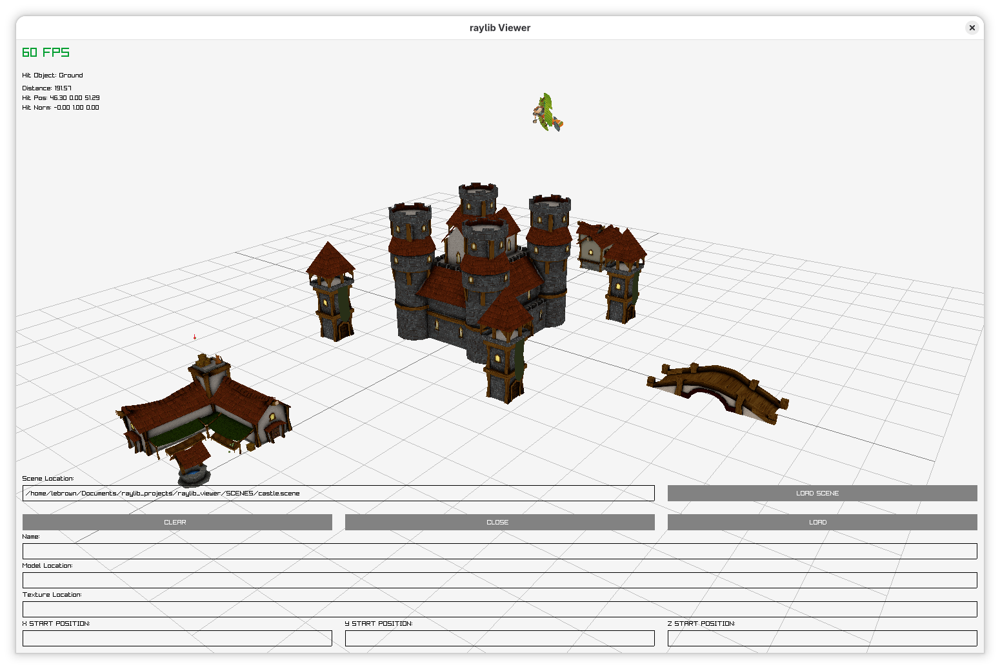
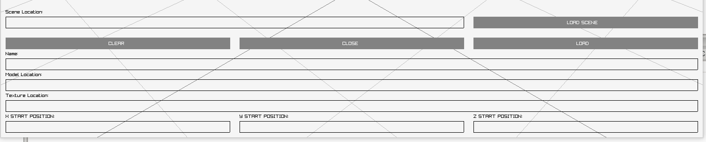
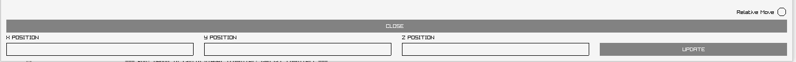

# raylib_viewer
***

3d model viewer with basic operations to load models then move scale and rotate them in a 3d space. Uses [Raylib](https://github.com/raysan5/raylib) libray to display simple models and detect when the cursor collides with a model. All menu's for the viewer are accessed via a keyboard shortcut, however you must close the current menu before accessing another.

## Viewer Preview

## Menu Overview

* **OPEN** (*Ctrl + o*)
* **SAVE** (*Ctrl + s*)
* **MOVE** (*Ctrl + m*)
* **SCALE** (*Ctrl + x*)
* **ROTATE** (*Ctrl + r*)

**OPEN MENU:**

To load a model enter a unique name then specify the model and texture locations and click load. A scene is simply a file that contains the information to load multiple models.

Once a models have been loaded you can use the left and right arrow keys to quickly scroll through any previously loaded models.

*Note if no starting position is specified models are loaded at the origin and center clicking in the open menu will set the start position to the cursors collision point this allows you to quickly load models around the ground plane*

**MOVE MENU:**

In the move menu center clicking populates the xyz values with the collision point between the mouse and the ground plane or model.

*Note that the Relative Move radio button can be clicked to enable a move relative to the models current position*